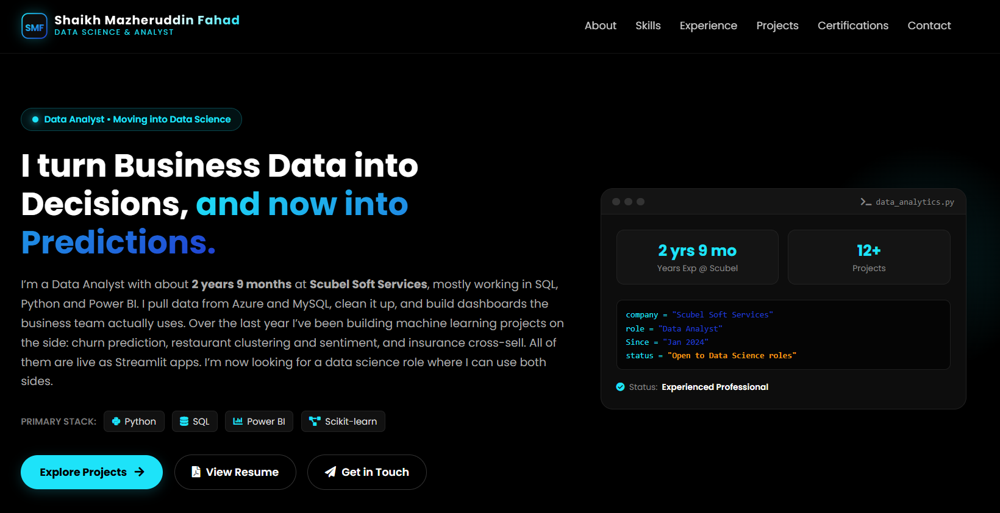

# Portfolio – Shaikh Mazheruddin Fahad

My personal portfolio site. I'm a data analyst at Scubel Soft Services (SQL, Python, Power BI) and I'm moving into data science, so the site covers both sides: the analytics work I do day to day and the machine learning projects I build on my own.

**Live site:** https://shaikh-mazher01.github.io/Portfolio/




## What's on the site

- **Hero and About:** who I am, what I work on, and the education timeline
- **Skills:** filterable by Languages and SQL, Machine Learning, Python Libraries, and BI and Tools
- **Experience:** my role at Scubel Soft Services since January 2024
- **Projects:** 12 projects with a filter for Machine Learning, Python and Web Scraping, SQL, and Dashboards
- **Certifications:** with links to verify each one
- **Contact:** a working form that sends messages to my email

## Featured projects

| Project | What it does | Links |
|---|---|---|
| Customer Churn Prediction | Predicts which customers are likely to leave, with SHAP to show why | [Live app](https://customerchurnprediction-zkbeoitb8v2dkq45n7wnto.streamlit.app/) · [Code](https://github.com/Shaikh-Mazher01/Customer_Churn_Prediction) |
| Health Insurance Cross-Sell Prediction | Ranks customers by how likely they are to buy vehicle insurance (LightGBM, 0.858 ROC-AUC) | [Live app](https://classificationhealthinsurance-byfahad.streamlit.app/) · [Code](https://github.com/Shaikh-Mazher01/Classification_Health_Insurance) |
| Zomato Restaurant Clustering and Sentiment | Groups 100 Hyderabad restaurants and scores their reviews | [Live app](https://zomatoresturantclustering-byfahad.streamlit.app/) · [Code](https://github.com/Shaikh-Mazher01/Zomato_Resturant_Clustering) |

## Built with

- HTML, CSS and plain JavaScript (no framework)
- [Font Awesome](https://fontawesome.com/) 5.15 for icons
- [Vanilla-Tilt](https://micku7zu.github.io/vanilla-tilt.js/) for the profile image effect
- [Web3Forms](https://web3forms.com/) for the contact form
- GitHub Pages for hosting

## Project structure

```
Portfolio/
├── index.html
├── assets/
│   ├── css/style.css
│   ├── js/script.js
│   └── images/
│       ├── projects/       project thumbnails
│       ├── certificate/    certificate images
│       └── Education/      education photos
├── LICENSE
└── README.md
```

## Contact

- Email: sfahad7020@gmail.com
- LinkedIn: https://www.linkedin.com/in/shaikh-mazheruddin-fahad-33183a244/
- GitHub: https://github.com/Shaikh-Mazher01

## License

See the [LICENSE](LICENSE) file.